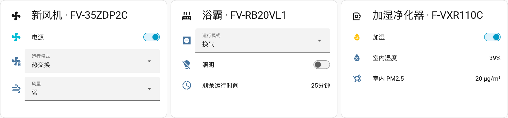
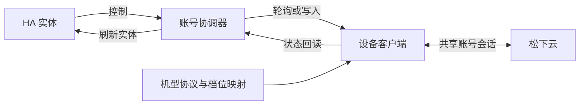

# Panasonic Smart CN

**首版 0.1** · [下载与发布说明](https://github.com/Aha-chen/panasonic_smart_cn/releases/tag/v0.1)

把中国大陆「松下智能家电」App 里已绑定的新风机、浴霸和空气净化器接入 Home Assistant。配网沿用松下 App，日常查看状态、调整档位和编写自动化都可以在 HA 中完成。集成通过松下云通信，运行时无需手机常开或安装 APK。

*Home Assistant 原生实体卡片示例。三台设备使用演示数据，卡片可按自己的仪表盘布局添加。*

[查看设备支持范围](#设备与功能) · [安装并添加设备](#install) · [了解项目结构](#architecture)

## ✨ 用起来有什么不同？

- **一个账号管理多台设备。** 登录后勾选家里的设备，新风、浴霸和净化器共用一个会话。以后添了设备，在同一配置条目里重新选择即可。
- **按机型呈现松下 App 里的档位。** 适配时从 APK 资源提取型号和模式，再用对应控制页核对实际指令。例如 LD6C 提供「低噪音／弱／强」三档。切到消毒时，风量控件随设备锁定为强风。不同机型的同名模式也可以使用各自的协议值。
- **操作后能看到云端是否确认。** 切换持久状态后，集成会回读并核对刚改的字段。云端接收了指令、回读却仍是旧值时，HA 会提示状态尚未确认，方便判断是否需要查看设备。
- **直接用原生实体做自动化。** 例如给 FV-RB20VL1 的照明设定时关闭，或让 VXR110C 的室内湿度传感器触发加湿开关。各设备只显示其协议提供的控件。

## 设备与功能

| 品类 | 适配型号或云端子类型 | 在 HA 中可以做什么 |
| --- | --- | --- |
| 薄型新风 LD6C | FV-25ZDP2C、FV-35ZDP2C、FV-50ZDP2C | 开关机，切换热交换、内循环、自动 ECO、消毒，调节三档风量 |
| 其他新风换气机 | DCERV、MidERV、NewDCERV（FV-RZ09VD2）、LD5C（FY-25ZDP1C）、Aircle-13-03 | 开关、模式、风量。环境读数、滤网和附加开关随协议而异 |
| 小型新风 | SmallERV、SmallERV02（FY-25ZM1C） | 开关、两档风量。SmallERV02 还提供室外环境读数与滤网倒计时 |
| 壁挂、薄型及柜式新风 | ERV（FV-09ZVDH1C、FV-RZ09VD1）、LD5C-X（FY-15/25/35ZDP1CX）、CABINET（FY-50ZR1C、FY-70ZR1C） | 开关、机型对应的运行模式，三档或五档风量 |
| 浴霸 | FV-RB20VL1、FV-54BA1C | 待机、取暖、换气、干燥和剩余运行时间。RB20VL1 可开关照明，54BA1C 提供 24 小时换气与除菌 |
| 空气净化器 | F-PXP60C、F-63C8PX、F-VXR110C、F-113C8VX | 开关、风量、预设模式与滤网余量。后两款还提供加湿开关、PM2.5 和室内湿度 |

添加时可看到每台设备匹配的协议。显示「仅状态」时，可查看设备诊断和云端提供的已知读数。中央空调（`0900`）目前归入「仅状态」。[完整型号与适配说明](Panasonic-Smart-CN.md)

## 🔧 安装与添加设备

1. 在中国区「松下智能家电」App 中完成配网和绑定，确认目标设备出现在该账号下。
2. 把本项目的 `custom_components/panasonic_smart_cn` 整个目录复制到 Home Assistant 的配置目录。以 HAOS 为例，完成后应能找到 `/config/custom_components/panasonic_smart_cn/manifest.json`。
3. 重启 Home Assistant Core，打开 **设置 → 设备与服务 → 添加集成**，搜索 **Panasonic Smart CN**。
4. 使用同一松下账号和密码登录，勾选设备并提交。打开设备页即可查看对应实体。新风机可用风机卡片开关机，也可用「风量」和「运行模式」下拉框选择设备支持的档位。

以后在 App 绑定新设备，或想调整已选设备时，到现有配置条目的菜单选择 **重新配置**。卸载时，先在「设备与服务」删除本集成的配置条目，再移除组件目录并重启 Core。设备仍绑定在松下 App 中。

## 状态刷新与控制

- **刷新频率**默认为 60 秒，可在集成选项中调整为 10–900 秒。同一账号下的设备共用云端会话。
- **控制回读**会在开关机、调风量或切换模式后比对云端状态，最多尝试三次，回读阶段最长 15 秒。提示「松下云已接收指令，但在等待时间内未读到与指令一致的状态」时，先看设备或 App 的实际状态，再观察下一次刷新。部分旧协议只能回读账号快照，滤网复位等一次性操作仅能确认云端接收。
- **账号重新认证**会在会话失效时由 Home Assistant 提示。自动重新登录默认关闭，可在集成选项开启，开启后可能影响手机 App 的登录状态。

## 排查与反馈

| 遇到的问题 | 可以检查什么 |
| --- | --- |
| 重启后搜不到集成 | 检查组件目录是否多套了一层，确认上面给出的路径能直接找到 manifest.json，再查看 Core 启动日志 |
| 登录成功但没有想选的设备 | 在 App 中核对当前账号和绑定清单，再从已有配置条目选择「重新配置」 |
| 设备已添加，但没有预期的控件 | 在设备页查看「设备协议」，与上表核对。若只显示「仅状态」，反馈销售型号和预期功能有助于后续适配 |
| 控制失败或状态迟迟不更新 | 在 App 确认设备在线，检查 HA 是否提示重新认证，并从集成条目菜单下载诊断 |

反馈时请附组件版本、HA Core 版本、销售型号、复现步骤和预期／实际表现。下载的诊断包含协议、轮询结果与状态字段数量。账号密码、设备标识、原始报文与 APK 请留在本地。

## 项目结构与数据流

以调风量为例，HA 的「风量」实体把档位交给账号协调器。设备客户端按机型生成请求，收到松下云响应后回读状态。协调器再把确认的风量提供给设备页和自动化。

| 想了解什么 | 从哪里看 |
| --- | --- |
| 登录、勾选设备与重新认证 | [配置流程](custom_components/panasonic_smart_cn/config_flow.py) |
| 一个账号怎样更新多台设备 | [账号协调器](custom_components/panasonic_smart_cn/coordinator.py) 与 [云端通信](custom_components/panasonic_smart_cn/api/) |
| 某个型号的档位、字段与读写接口 | [机型协议](custom_components/panasonic_smart_cn/protocol/) |
| 设备怎样出现在 HA 中 | [实体平台](custom_components/panasonic_smart_cn/) 中的 fan、select、light、switch、sensor 和 button |
| 如何贡献机型适配 | [贡献指南](CONTRIBUTING.md) |

## 协议来源与致谢

登录、会话、绑定设备清单和设备令牌沿用已有松下中国区集成的通信方法。DCERV、MidERV 等新风协议的报文与字段映射复用了社区工作，感谢 rudyll 及上游贡献者公开这些实现。[松下中国区集成](https://github.com/mcdona1d/panasonic_smart_china) · [社区新风协议](https://github.com/rudyll/panasonic_smart_china_r) · [随组件分发的 MIT 许可与署名](custom_components/panasonic_smart_cn/LICENSE)

本项目从中国区 App 4.101.0 的 APK 资源整理销售型号、子类型和界面档位，并对照松下 Web 控制页的读写端点、字段和取值，适配浴霸、净化器及更多新风系列。例如 LD5C-X 与 LD5C 共用写入接口，读取状态却要走各自的接口。在 HA 侧，本项目把这些协议接入同一个账号协调器，并实现按设备串行控制、状态回读与模式联动。[机型资料与控制脚本出处](Panasonic-Smart-CN.md) · [开发与贡献](CONTRIBUTING.md)

本项目新增代码采用 [MIT 许可证](LICENSE)。
